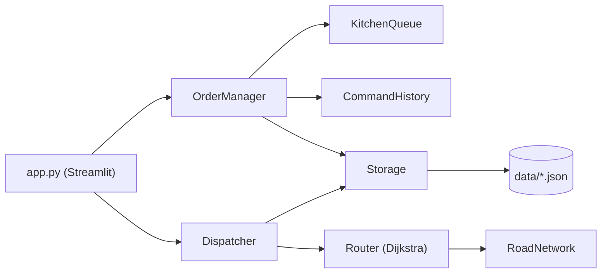
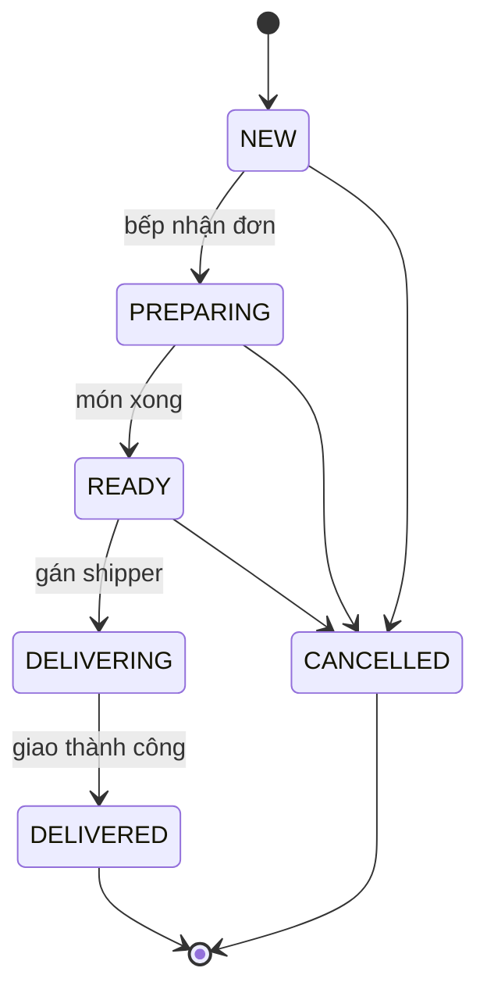

# Hệ thống Quản lý Đơn hàng & Điều phối Shipper

> Đồ án Module 1: Xây dựng ứng dụng quản lý tương tác bằng Python.
> Nhóm: `DUT_AI` · Mentor: `Quế Đình Anh Tú` · Repo: `https://github.com/HcmusGo/Report-Module_1`

## 1. Giới thiệu

Ứng dụng mô phỏng phần **back-office của một quán ăn giao hàng** (kiểu GrabFood/ShopeeFood thu nhỏ). Hệ thống giải quyết hai việc gắn liền với nhau:

1. **Quản lý đơn hàng:** nhận đơn, đưa vào hàng đợi bếp, theo dõi trạng thái chế biến và tính tiền.
2. **Điều phối shipper:** khi món xong, hệ thống tìm shipper rảnh **gần quán nhất** và vẽ lộ trình ngắn nhất `shipper → quán → khách` bằng thuật toán **Dijkstra**.

Mọi thao tác thay đổi dữ liệu (tạo đơn, hủy đơn, đổi trạng thái, gán shipper, khóa đường) đều có thể **Undo / Redo**. Dữ liệu được lưu bằng file JSON, không dùng database.

## 2. Tính năng

**Bắt buộc (MVP)**
- [ ] CRUD: món ăn (menu), khách hàng, shipper, địa điểm và đường trên bản đồ
- [ ] Tạo đơn hàng, tính tổng tiền, tìm kiếm và lọc đơn (theo trạng thái, khách, ngày)
- [ ] Hàng đợi bếp (FIFO): đơn vào trước được chế biến trước
- [ ] Dijkstra tìm đường ngắn nhất trên bản đồ
- [ ] Gán shipper rảnh gần quán nhất, tính ETA và phí ship
- [ ] Undo / Redo bằng Stack
- [ ] Lưu và khôi phục dữ liệu qua JSON, xử lý lần chạy đầu khi chưa có file\*

## 3. Công nghệ

| Hạng mục | Công cụ |
|---|---|
| Ngôn ngữ | Python 3.11+ (khuyến nghị) |
| Quản lý dự án | [uv](https://docs.astral.sh/uv/) (`pyproject.toml`, `uv.lock`) |
| Giao diện | Streamlit |
| Vẽ bản đồ | Plotly |
| Lưu trữ | JSON trong thư mục `data/` |
| Kiểm thử | pytest (dev dependency) |
| Quản lý mã nguồn | Git / GitHub, Git Flow theo nhánh tính năng |

## 4. Cài đặt và chạy

```bash
# 1. Cài uv (nếu chưa có)
pip install uv

# 2. Lấy mã nguồn
git clone <https://github.com/HcmusGo/Report-Module_1.git>
cd <Module_1>

# 3. Đồng bộ môi trường theo pyproject.toml / uv.lock
uv sync

# 4. Chạy ứng dụng
uv run streamlit run src/app.py
```

Mở trình duyệt tại `http://localhost:8501`.

Chạy kiểm thử:

```bash
uv run pytest
```

Thêm thư viện mới (chỉ làm trong branch của mình, rồi commit cả `pyproject.toml` và `uv.lock`):

```bash
uv add <tên-thư-viện>
uv add --dev pytest
```

## 5. Kiến trúc

Ứng dụng chia 3 tầng. **UI chỉ gọi hàm của `core/` và hiển thị kết quả, không chứa logic nghiệp vụ.**



### Cấu trúc thư mục

```
delivery-system/
├── data/
│   └── sample/              # Dữ liệu mẫu (có commit): menu, khách, shipper, bản đồ
│                            # File chạy thật (orders.json, ...) nằm trong .gitignore
├── src/
│   ├── models/              # Entity OOP
│   │   ├── base.py          # Lớp cơ sở: to_dict() / from_dict()
│   │   ├── menu_item.py
│   │   ├── customer.py
│   │   ├── order.py         # Order, OrderItem, Enum OrderStatus
│   │   ├── shipper.py       # Shipper, Enum ShipperStatus
│   │   └── map_entities.py  # Place, Road
│   ├── core/                # Cấu trúc dữ liệu và logic nghiệp vụ
│   │   ├── storage.py       # Đọc / ghi JSON
│   │   ├── order_manager.py # CRUD đơn, chuyển trạng thái, tìm kiếm, lọc
│   │   ├── kitchen_queue.py # Hàng đợi bếp (deque)
│   │   ├── history.py       # Command + CommandHistory (Undo / Redo bằng 2 Stack)
│   │   ├── road_network.py  # Đồ thị bản đồ, khóa / mở đường
│   │   ├── routing.py       # Router (ABC) → DijkstraRouter, BFSRouter
│   │   └── dispatcher.py    # Gán shipper, lộ trình 2 chặng, ETA, phí ship
│   └── app.py               # Giao diện Streamlit (2 tab)
├── tests/                   # Unit test
├── docs/                    # Report mô tả dự án (mỗi chương một file .md)
├── .gitignore
├── pyproject.toml
├── uv.lock
└── README.md
```


## 6. Nghiệp vụ

### Vòng đời đơn hàng



### Công thức (đề xuất, nhóm chốt ở buổi họp ngày 0)

| Đại lượng | Công thức |
|---|---|
| Trọng số mỗi đường | `thời gian = km / tốc độ × hệ số kẹt xe` (luôn ≥ 0) |
| Phí ship | `15.000 + 5.000 × km` (VNĐ) |
| ETA | thời gian bếp còn lại + thời gian `shipper → quán` + thời gian `quán → khách` |
| Shipper được chọn | shipper rảnh có thời gian đến quán nhỏ nhất (Dijkstra chạy **một lần từ quán**) |

### Phạm vi giới hạn

- Một quán duy nhất, mỗi khách gắn với một địa điểm (nút) trên bản đồ.
- Bản đồ tự vẽ khoảng 25–40 nút, ở bản đầu đường hai chiều. Không dùng dữ liệu OpenStreetMap.
- Shipper di chuyển mô phỏng, không dùng GPS thật.

## 7. Cấu trúc dữ liệu và thuật toán

| Cấu trúc / Thuật toán | Dùng ở đâu | Vì sao chọn | Độ phức tạp |
|---|---|---|---|
| **Dict** | `orders[id]`, `menu[code]`, danh sách kề của đồ thị | Tra cứu, sửa, xóa theo khóa | O(1) |
| **Queue** (`deque`) | Hàng đợi bếp | FIFO, `popleft()` nhanh hơn `list.pop(0)` | O(1) |
| **Stack** (`list`) | `undo_stack`, `redo_stack` | LIFO, hoàn tác thao tác gần nhất trước | O(1) |
| **Priority Queue** (`heapq`) | Dijkstra | Luôn lấy nút có khoảng cách nhỏ nhất | O(log n) |
| **Set** | Tập `visited`, tập shipper đang bận, tag món | Kiểm tra thuộc tập nhanh | O(1) |
| **Dijkstra** | Đường ngắn nhất, chọn shipper gần nhất | Cạnh có trọng số không âm | O((V+E) log V) |
| **BFS** | Đối chứng với Dijkstra | Chỉ đúng khi mọi cạnh cùng trọng số | O(V+E) |

**Undo / Redo** theo **Command pattern**: mỗi thao tác là một lớp có `apply()` và `undo()` (`CreateOrderCmd`, `CancelOrderCmd`, `ChangeStatusCmd`, `AssignShipperCmd`...). Khi có thao tác mới, `redo_stack` bị xóa. Undo việc gán shipper phải trả shipper về trạng thái rảnh và đưa đơn về `READY`.

## 8. Dữ liệu và lưu trữ

| File | Nội dung |
|---|---|
| `data/menu.json` | Món ăn: mã, tên, giá, thời gian chế biến |
| `data/customers.json` | Khách hàng và nút trên bản đồ |
| `data/shippers.json` | Shipper, trạng thái, vị trí hiện tại |
| `data/map.json` | Địa điểm (nút) và đường (cạnh) |
| `data/orders.json` | Đơn hàng và các dòng món |

- Lần chạy đầu, nếu file chưa có thì tự sao chép từ `data/sample/`, nếu không có mẫu thì tạo danh sách rỗng. Ứng dụng không được crash.
- Nếu JSON bị hỏng, `storage.py` bắt `json.JSONDecodeError`, sao lưu file lỗi (`.bak`) rồi khởi tạo lại.
- Ghi file với `encoding="utf-8"` và `ensure_ascii=False` để không lỗi tiếng Việt có dấu.

## 9. Giao diện

| Tab | Nội dung |
|---|---|
| **1. Quản lý dữ liệu** | Bảng danh sách và form thêm / sửa / xóa cho menu, khách hàng, shipper, địa điểm, đường (chỉnh trọng số, khóa đường) |
| **2. Điều phối đơn** | Tạo đơn, hàng đợi bếp, nút "Bếp xong món", "Gán shipper", bản đồ tuyến `shipper → quán → khách`, ETA, phí ship, nút Undo / Redo |
| *(3. Thống kê, tùy chọn)* | Số đơn theo trạng thái, doanh thu, so sánh Dijkstra với BFS |

Manager phải được giữ trong `st.session_state`, nếu không Stack Undo bị reset sau mỗi lần bấm nút.

## 10. Nhóm thực hiện và phân công

Nhóm 5 thành viên. Khối lượng được chia theo độ phức tạp của phần việc: ba phần **Core Logic**, **Routing** và **UI** là các phần nặng nhất, hai phần còn lại nhẹ hơn về code nhưng đảm nhận thêm tài liệu và kiểm thử.

| STT | Họ tên | GitHub | Vai trò | Branch | Tỷ trọng ước tính |
|---|---|---|---|---|---|
| 1 | Lê Trí Tiên | `@HcmusGo` | Trưởng nhóm, Core Logic | `feat/logic` | ~24% |
| 2 | Đào Đoàn Đỗ Quyên | `@...` | Models và phân tích nghiệp vụ | `feat/models` | ~14% |
| 3 | Nguyễn Lê Đức Bảo | `@cleivoid` | Routing và điều phối shipper | `feat/routing` | ~24% |
| 4 | Nguyễn Vũ Băng Tâm | `@...` | Storage, kiểm thử và dữ liệu mẫu | `feat/storage` | ~14% |
| 5 | Thân Văn Thế Lâm | `@...` | Giao diện và tích hợp | `feat/ui` | ~24% |

### Nhiệm vụ chi tiết

**Lê Trí Tiên: Trưởng nhóm, Core Logic**
- Dựng repo, `uv init`, cấu trúc thư mục, điều phối merge PR, chốt "hợp đồng hàm" giữa các module
- `core/order_manager.py`: CRUD đơn, chuyển trạng thái, tìm kiếm, lọc
- `core/kitchen_queue.py`: hàng đợi bếp (`enqueue`, `next_order`, `peek`, `size`)
- `core/history.py`: `Command` (ABC), `CommandHistory`, các lớp lệnh, Undo / Redo bằng 2 Stack


**Nguyễn Lê Đức Bảo: Routing và điều phối shipper**
- `core/road_network.py`: đồ thị, thêm / sửa / xóa đường, khóa đường, hệ số kẹt xe
- `core/routing.py`: `Router` (ABC), `DijkstraRouter`, `BFSRouter`, thống kê số nút đã duyệt
- `core/dispatcher.py`: gán shipper gần nhất, lộ trình 2 chặng, ETA, phí ship
- Thiết kế bản đồ mẫu 25–40 nút


**Thân Văn Thế Lâm: Giao diện và tích hợp**
- `src/app.py`: Streamlit 2 tab, `st.session_state`, form CRUD, bảng hiển thị
- Vẽ bản đồ và tuyến đường bằng Plotly
- Thông báo thành công / lỗi, nút Undo / Redo (vô hiệu hóa khi Stack rỗng), `st.rerun()` để cập nhật ngay
- Tích hợp các module, chuẩn bị bản demo


**Đào Đoàn Đỗ Quyên: Models và phân tích nghiệp vụ**
- `models/`: `BaseEntity`, `MenuItem`, `Customer`, `Order`, `OrderItem`, `Shipper`, `Place`, `Road`, các Enum trạng thái
- Đóng gói (thuộc tính private + property), validate trong setter, `to_dict()` / `from_dict()`
- Unit test cho models


**Nguyễn Vũ Băng Tâm: Storage, kiểm thử và dữ liệu mẫu**
- `core/storage.py`: đọc / ghi JSON, tạo file khi chưa có, xử lý JSON hỏng, UTF-8
- Dữ liệu mẫu `data/sample/`, `.gitignore`
- Viết bảng test case, unit test cho storage và routing (phối hợp với Bảo), kiểm thử tích hợp
- Kịch bản demo, cập nhật README và ảnh chụp giao diện
- Tài liệu: mục 5.2 (lưu trữ), Chương 7 (Git, kế hoạch, rủi ro), Chương 8 (kiểm thử, nghiệm thu)

### Nguyên tắc chung

- **Mọi thành viên đều có commit và Pull Request** trong suốt dự án, phần việc nhẹ hơn không có nghĩa là ít đóng góp trong lịch sử Git.
- Mỗi thành viên giải thích được **kiến trúc tổng thể** và lý do chọn từng cấu trúc dữ liệu, không chỉ phần của mình.
- Tỷ trọng chỉ là ước tính ban đầu, nhóm điều chỉnh nếu phần nào phát sinh nhiều việc.

### Review chéo

| Pull Request | Tác giả | Reviewer chính |
|---|---|---|
| `feat/models` | Đào Đoàn Đỗ Quyên | Nguyễn Lê Đức Bảo |
| `feat/storage` | Nguyễn Vũ Băng Tâm | Đào Đoàn Đỗ Quyên |
| `feat/logic` | Lê Trí Tiên | Thân Văn Thế Lâm |
| `feat/routing` | Nguyễn Lê Đức Bảo | Nguyễn Vũ Băng Tâm |
| `feat/ui` | Thân Văn Thế Lâm | Lê Trí Tiên |

## 11. Quy ước Git

- `main` là nhánh sản phẩm, **không push trực tiếp**, chỉ merge qua Pull Request đã được ít nhất 1 người review.
- Mỗi tính năng một nhánh: `feat/models`, `feat/storage`, `feat/logic`, `feat/routing`, `feat/ui`. Tài liệu dùng nhánh `docs/...`.
- Commit message theo dạng: `feat: ...`, `fix: ...`, `docs: ...`, `test: ...`, `refactor: ...`, `chore: ...`.
  Ví dụ: `feat: add undo stack for order commands`
- Không commit `.venv/`, `__pycache__/`, dữ liệu chạy thật (`data/*.json`), file test tạm.

Quy trình làm việc:

```bash
git checkout main && git pull
git checkout -b feat/<tên-tính-năng>
# ... code, commit nhỏ và thường xuyên ...
git push -u origin feat/<tên-tính-năng>
# Mở Pull Request trên GitHub, gắn reviewer, sửa theo comment, merge
```
## 12. Kịch bản demo

1. Mở app lần đầu khi chưa có file dữ liệu (app tự tạo từ dữ liệu mẫu).
2. Thêm món, khách hàng; tạo một đơn mới.
3. Chuyển đơn qua hàng đợi bếp, bấm "Bếp xong món".
4. Gán shipper, xem tuyến `shipper → quán → khách`, ETA và phí ship.
5. Khóa một đường trên tuyến, xem tuyến được tính lại.
6. Bấm **Undo** nhiều lần, rồi **Redo**, quan sát giao diện thay đổi.
7. Tắt và mở lại app, dữ liệu vẫn còn.

## 14. Đối chiếu tiêu chí đánh giá

| Tiêu chí | Cách dự án đáp ứng |
|---|---|
| Quản lý dự án và Git | `uv` + `pyproject.toml` + `uv.lock`; nhánh `feat/*`; PR có review; mọi thành viên có commit |
| OOP và Clean Code | Models / Core / UI tách tầng; đóng gói bằng thuộc tính private; kế thừa qua `Command` và `Router`; `app.py` không chứa logic |
| Cấu trúc dữ liệu và lưu file | Dict, Queue, Stack, Priority Queue, Set; Dijkstra; JSON trong `data/`, xử lý file chưa có và file hỏng |
| Giao diện và trải nghiệm | 2 tab Streamlit; phản hồi ngay khi thêm / sửa / xóa / Undo / Redo; thông báo thành công và lỗi |
| Trình bày | Kịch bản demo ở mục 13; mỗi thành viên nắm kiến trúc tổng thể |

## 15. Tài liệu

Report mô tả dự án nằm trong thư mục DOCUMENT, mỗi chương một file. Người phụ trách từng chương xem ở mục 10.

Link Documents đã nộp cho mốc 11/10: `https://surl.li/aguqnx` (kiểm tra mentor có quyền truy cập trước khi nộp).
