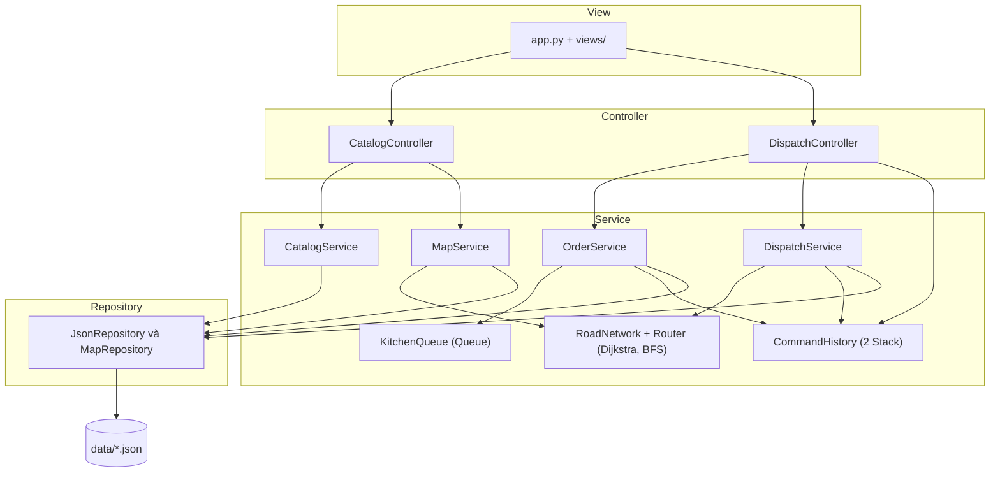
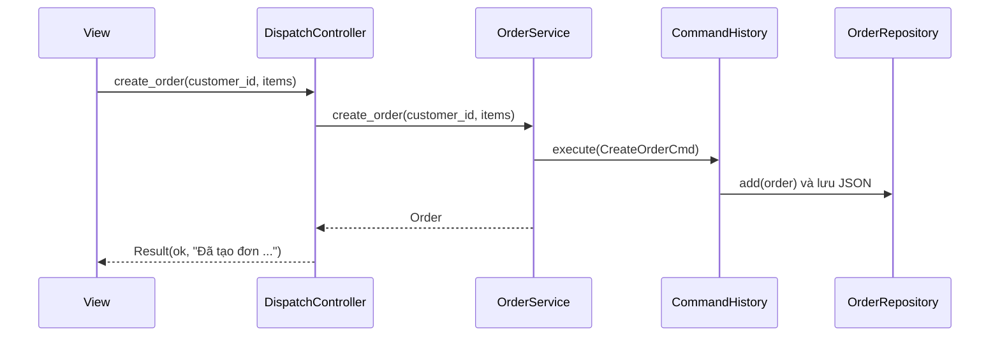
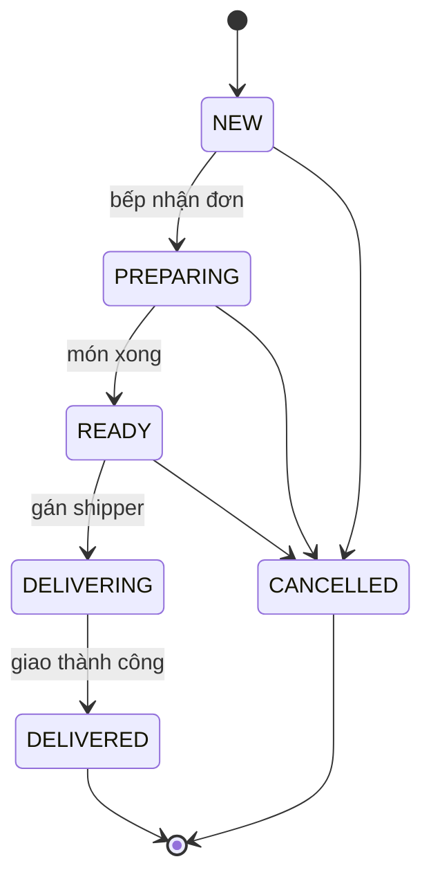

# Hệ thống Quản lý Đơn hàng & Điều phối Shipper

> Đồ án Module 1: Xây dựng ứng dụng quản lý tương tác bằng Python.
> Nhóm: `DUT_AI` · Mentor: `Quế Đình Anh Tú` · Repo: `https://github.com/HcmusGo/Report-Module_1`

## 1. Giới thiệu

Ứng dụng mô phỏng phần **back-office của một quán ăn giao hàng** (kiểu GrabFood/ShopeeFood thu nhỏ). Hệ thống giải quyết hai việc gắn liền với nhau:

1. **Quản lý đơn hàng:** nhận đơn, đưa vào hàng đợi bếp, theo dõi trạng thái chế biến và tính tiền.
2. **Điều phối shipper:** khi món xong, hệ thống tìm shipper rảnh **gần quán nhất** và vẽ lộ trình ngắn nhất `shipper → quán → khách` bằng thuật toán **Dijkstra**.

Mọi thao tác thay đổi dữ liệu (tạo đơn, hủy đơn, đổi trạng thái, gán shipper, khóa đường) đều có thể **Undo / Redo**. Dữ liệu được lưu bằng file JSON, không dùng database.

Mã nguồn tổ chức theo **kiến trúc 3 tầng (Controller – Service – Repository)**

## 2. Tính năng

**Bắt buộc (MVP)**
- [ ] CRUD: món ăn (menu), khách hàng, shipper, địa điểm và đường trên bản đồ
- [ ] Tạo đơn hàng, tính tổng tiền, tìm kiếm và lọc đơn (theo trạng thái, khách, từ khóa)
- [ ] Hàng đợi bếp (FIFO): đơn vào trước được chế biến trước
- [ ] Dijkstra tìm đường ngắn nhất trên bản đồ
- [ ] Gán shipper rảnh gần quán nhất, tính ETA và phí ship
- [ ] Khóa / mở đường, tuyến đường tự tính lại
- [ ] Undo / Redo bằng Stack
- [ ] Lưu và khôi phục dữ liệu qua JSON, xử lý lần chạy đầu khi chưa có file

## 3. Công nghệ

| Hạng mục | Công cụ |
|---|---|
| Ngôn ngữ | Python 3.11+ (khuyến nghị) |
| Quản lý dự án | [uv](https://docs.astral.sh/uv/) (`pyproject.toml`, `uv.lock`) |
| Giao diện | Streamlit |
| Vẽ bản đồ | Plotly |
| Lưu trữ | JSON trong thư mục `data/` |
| Kiểm thử | pytest (dev dependency) |
| Quản lý mã nguồn | Git / GitHub, Git Flow theo nhánh tính năng |

## 4. Cài đặt và chạy

```bash
# 1. Cài uv (nếu chưa có)
pip install uv

# 2. Lấy mã nguồn
git clone https://github.com/HcmusGo/Report-Module_1.git
cd Report-Module_1

# 3. Đồng bộ môi trường theo pyproject.toml / uv.lock
uv sync

# 4. Chạy ứng dụng
uv run streamlit run src/app.py
```

Mở trình duyệt tại `http://localhost:8501`.

Chạy kiểm thử:

```bash
uv run pytest
```

Thêm thư viện mới (chỉ làm trong branch của mình, rồi commit cả `pyproject.toml` và `uv.lock`):

```bash
uv add <tên-thư-viện>
uv add --dev pytest
```
>
> Khi chạy `streamlit run src/app.py`, thư mục `src/` nằm trong `sys.path`, nên import theo dạng `from services.order_service import OrderService`, **không** dùng `from src.services...`. File `pytest.ini` đã cấu hình `pythonpath = src` cho test.

## 5. Kiến trúc 3 tầng

```
View  →  Controller  →  Service  →  Repository  →  data/*.json
                                 ↘  Models (entity) dùng chung cho mọi tầng
```

| Tầng | Thư mục | Làm gì | Không được làm |
|---|---|---|---|
| **View** | `src/app.py`, `src/views/` | Vẽ giao diện Streamlit, gọi Controller, hiển thị kết quả | Chứa luật nghiệp vụ, gọi Service hay Repository trực tiếp |
| **Controller** | `src/controllers/` | Nhận thao tác từ giao diện, gọi Service, bắt lỗi và trả `Result`, đổi dữ liệu thành bảng để hiển thị | Chứa luật nghiệp vụ, import `streamlit` |
| **Service** | `src/services/` | Toàn bộ nghiệp vụ: đơn hàng, hàng đợi bếp, Undo / Redo, đồ thị, Dijkstra, gán shipper, phí ship, ETA | Import `streamlit`, đọc ghi file |
| **Repository** | `src/repositories/` | Đọc, ghi, tìm dữ liệu JSON | Chứa luật nghiệp vụ |
| **Models** | `src/models/` | Thực thể (Entity), validate, `to_dict()` / `from_dict()` | Biết đến tầng khác |

Việc ghép nối các tầng nằm ở một chỗ duy nhất là `src/container.py` (**Dependency Injection**): Service nhận Repository qua constructor và chỉ biết giao diện `Repository`, không biết dữ liệu nằm ở JSON hay nơi khác.



### Luồng ví dụ: tạo đơn hàng



Ví dụ lợi ích của việc tách tầng:
- Đổi công thức phí ship: chỉ sửa `DispatchService` (hằng số ở `config.py`).
- Đổi JSON sang CSV hoặc SQLite: chỉ viết Repository mới, Service và Controller giữ nguyên.
- Đổi Streamlit sang Gradio: chỉ sửa View.
- Test được toàn bộ nghiệp vụ mà không cần mở giao diện.

### Cấu trúc thư mục

```
Report-Module_1/
├── data/
│   └── sample/                  # Dữ liệu mẫu (có commit)
│                                # File chạy thật (data/*.json) nằm trong .gitignore
├── src/
│   ├── app.py                   # View: dựng trang, 2 tab, gọi views/
│   ├── container.py             # Ghép Repository → Service → Controller
│   ├── config.py                # Hằng số: đường dẫn data, phí ship, tốc độ
│   ├── exceptions.py            # AppError, ValidationError, NotFoundError, BusinessRuleError
│   ├── views/
│   │   ├── catalog_tab.py       # Tab 1: Quản lý dữ liệu
│   │   ├── dispatch_tab.py      # Tab 2: Điều phối đơn
│   │   └── map_plot.py          # Vẽ bản đồ bằng Plotly
│   ├── controllers/
│   │   ├── result.py            # Result(ok, message, data)
│   │   ├── catalog_controller.py
│   │   └── dispatch_controller.py
│   ├── services/
│   │   ├── order_service.py     # Tạo, hủy, đổi trạng thái, tìm kiếm, lọc đơn
│   │   ├── catalog_service.py   # CRUD menu, khách hàng, shipper
│   │   ├── map_service.py       # CRUD địa điểm, đường, khóa / mở đường
│   │   ├── dispatch_service.py  # Gán shipper, lộ trình 2 chặng, ETA, phí ship
│   │   ├── kitchen_queue.py     # Hàng đợi bếp (deque)
│   │   ├── history.py           # Command (ABC) + CommandHistory (2 Stack)
│   │   ├── commands.py          # CreateOrderCmd, CancelOrderCmd, ChangeStatusCmd, ...
│   │   ├── road_network.py      # Đồ thị bản đồ
│   │   └── routing.py           # Router (ABC) → DijkstraRouter, BFSRouter
│   ├── repositories/
│   │   ├── base_repository.py   # Repository (ABC)
│   │   ├── json_repository.py   # Cài đặt chung bằng JSON
│   │   ├── order_/menu_/customer_/shipper_repository.py
│   │   └── map_repository.py
│   └── models/
│       ├── base.py              # BaseEntity: to_dict() / from_dict()
│       ├── menu_item.py
│       ├── customer.py
│       ├── order.py             # Order, OrderItem, OrderStatus, quy tắc chuyển trạng thái
│       ├── shipper.py           # Shipper, ShipperStatus
│       └── map_entities.py      # Place, Road, PlaceKind
├── tests/                       # Unit test
├── DOCUMENT/                    # Report mô tả dự án (mỗi chương một file)
├── .github/                     # PR template, CODEOWNERS
├── .gitignore
├── pytest.ini
├── pyproject.toml
├── uv.lock
└── README.md

```

## 6. Nghiệp vụ

### Vòng đời đơn hàng



Quy tắc chuyển trạng thái nằm **một chỗ duy nhất** là `ALLOWED_TRANSITIONS` trong `models/order.py`. Đơn chỉ hủy được khi chưa giao cho shipper (`NEW`, `PREPARING`, `READY`).

### Công thức (đề xuất, nhóm chốt rồi sửa trong `config.py`)

| Đại lượng | Công thức |
|---|---|
| Trọng số mỗi đường | `thời gian (phút) = km / tốc độ × 60 × hệ số kẹt xe` (luôn ≥ 0) |
| Phí ship | `15.000 + 5.000 × km` (VNĐ) |
| ETA | thời gian bếp còn lại + thời gian `shipper → quán` + thời gian `quán → khách` |
| Shipper được chọn | shipper rảnh có thời gian đến quán nhỏ nhất (Dijkstra chạy **một lần từ quán**) |

### Phạm vi giới hạn

- Một quán duy nhất, mỗi khách gắn với một địa điểm (nút) trên bản đồ.
- Bản đồ tự vẽ khoảng 25–40 nút, ở bản đầu đường hai chiều. Không dùng dữ liệu OpenStreetMap.
- Shipper di chuyển mô phỏng, không dùng GPS thật.

## 7. Cấu trúc dữ liệu, thuật toán và mẫu thiết kế

### Cấu trúc dữ liệu và thuật toán

| Cấu trúc / Thuật toán | Dùng ở đâu | Vì sao chọn | Độ phức tạp |
|---|---|---|---|
| **Dict** | Index theo id trong `JsonRepository`, danh sách kề của đồ thị | Tra cứu, sửa, xóa theo khóa | O(1) |
| **Queue** (`deque`) | `KitchenQueue`: hàng đợi bếp | FIFO, `popleft()` nhanh hơn `list.pop(0)` | O(1) |
| **Stack** (`list`) | `CommandHistory`: `undo_stack`, `redo_stack` | LIFO, hoàn tác thao tác gần nhất trước | O(1) |
| **Priority Queue** (`heapq`) | `DijkstraRouter` | Luôn lấy nút có khoảng cách nhỏ nhất | O(log n) |
| **Set** | Tập `visited`, tag món | Kiểm tra thuộc tập nhanh | O(1) |
| **Dijkstra** | Đường ngắn nhất, chọn shipper gần nhất | Cạnh có trọng số không âm | O((V+E) log V) |
| **BFS** | `BFSRouter`: đối chứng với Dijkstra | Chỉ đúng khi mọi cạnh cùng trọng số | O(V+E) |

### Mẫu thiết kế

| Mẫu | Ở đâu | Tác dụng |
|---|---|---|
| **Repository** | `repositories/` | Tách việc lưu trữ khỏi nghiệp vụ, đổi nơi lưu không ảnh hưởng Service |
| **Command** | `services/history.py`, `commands.py` | Mỗi thao tác có `apply()` và `undo()`, nền tảng của Undo / Redo |
| **Strategy** | `services/routing.py` | `Router` (ABC) → `DijkstraRouter`, `BFSRouter`, đổi thuật toán và so sánh dễ dàng |
| **Dependency Injection** | `container.py` | Service nhận phụ thuộc qua constructor, dễ test, dễ thay thế |

**Undo / Redo:** khi có thao tác mới, `redo_stack` bị xóa. Undo việc gán shipper phải trả shipper về trạng thái rảnh và đưa đơn về `READY`. Lệnh cụ thể: `CreateOrderCmd`, `CancelOrderCmd`, `ChangeStatusCmd`, `AssignShipperCmd`, `SetRoadBlockedCmd`.

## 8. Dữ liệu và lưu trữ

| File | Nội dung |
|---|---|
| `data/menu.json` | Món ăn: mã, tên, giá, thời gian chế biến, tag |
| `data/customers.json` | Khách hàng và nút trên bản đồ |
| `data/shippers.json` | Shipper, trạng thái, vị trí hiện tại |
| `data/map.json` | `{"places": [...], "roads": [...]}`: địa điểm (nút) và đường (cạnh) |
| `data/orders.json` | Đơn hàng và các dòng món |

- Lần chạy đầu, nếu file chưa có thì tự sao chép từ `data/sample/`, nếu không có mẫu thì tạo danh sách rỗng. Ứng dụng không được crash.
- Nếu JSON bị hỏng, Repository bắt `json.JSONDecodeError`, đổi tên file lỗi thành `.bak` rồi khởi tạo lại.
- Ghi file với `encoding="utf-8"` và `ensure_ascii=False` để không lỗi tiếng Việt có dấu.
- Chỉ **Repository** được đọc ghi file. Các tầng khác không đụng vào `data/`.

## 9. Giao diện

| Tab | Nội dung |
|---|---|
| **1. Quản lý dữ liệu** | Bảng danh sách và form thêm / sửa / xóa cho menu, khách hàng, shipper, địa điểm, đường (chỉnh trọng số, khóa đường) |
| **2. Điều phối đơn** | Tạo đơn, hàng đợi bếp, nút "Bếp xong món", "Gán shipper", bản đồ tuyến `shipper → quán → khách`, ETA, phí ship, nút Undo / Redo |
| *(3. Thống kê, tùy chọn)* | Số đơn theo trạng thái, doanh thu, so sánh Dijkstra với BFS |

`app.py` chỉ dựng khung trang và gọi `views/`. `AppContext` (chứa các Controller) được giữ trong `st.session_state`, nếu không Stack Undo bị reset sau mỗi lần bấm nút. Giao diện chỉ gọi hàm của Controller, nhận `Result` rồi hiển thị bằng `st.success` hoặc `st.error`.

## 10. Nhóm thực hiện và phân công

| STT | Họ tên | GitHub | Vai trò | Branch | 
|---|---|---|---|---|---|
| 1 | Lê Trí Tiên | `@HcmusGo` | Trưởng nhóm, Core Logic | `feat/logic` |
| 2 | Đào Đoàn Đỗ Quyên | `@DUT26DoQuyen` | Models và phân tích nghiệp vụ | `feat/models` |
| 3 | Nguyễn Lê Đức Bảo | `@cleivoid` | Routing và điều phối shipper | `feat/routing` |
| 4 | Nguyễn Vũ Băng Tâm | `@btam200801` | Repository, kiểm thử và dữ liệu mẫu | `feat/repository` |
| 5 | Thân Văn Thế Lâm | `@thanvanthelam` | Controller, giao diện và tích hợp | `feat/ui` |

### Nhiệm vụ chi tiết

**Lê Trí Tiên: Trưởng nhóm, Core Logic**
- Quản lý repo, cấu trúc thư mục, điều phối merge PR, chốt "hợp đồng hàm" giữa các tầng
- `services/order_service.py`: tạo, hủy, đổi trạng thái, tìm kiếm, lọc đơn
- `services/kitchen_queue.py`: hàng đợi bếp (`enqueue`, `dequeue`, `peek`, `remove`)
- `services/history.py`, `services/commands.py`: `Command` (ABC), `CommandHistory`, các lệnh Undo / Redo bằng 2 Stack
- `container.py`, `config.py`, `exceptions.py`

**Nguyễn Lê Đức Bảo: Routing và điều phối shipper**
- `services/road_network.py`: đồ thị, trọng số theo thời gian, bỏ qua đường bị khóa
- `services/routing.py`: `Router` (ABC), `DijkstraRouter`, `BFSRouter`, thống kê số nút đã duyệt
- `services/dispatch_service.py`: gán shipper gần nhất, lộ trình 2 chặng, ETA, phí ship
- `services/map_service.py`: CRUD địa điểm, đường, khóa / mở đường; `SetRoadBlockedCmd`
- Thiết kế bản đồ mẫu 25–40 nút

**Thân Văn Thế Lâm: Controller, giao diện và tích hợp**
- `controllers/`: `CatalogController`, `DispatchController`, `Result`
- `app.py`, `views/`: Streamlit 2 tab, `st.session_state`, form CRUD, bảng hiển thị
- Vẽ bản đồ và tuyến đường bằng Plotly (`views/map_plot.py`)
- Thông báo thành công / lỗi, nút Undo / Redo (vô hiệu hóa khi Stack rỗng), `st.rerun()` để cập nhật ngay
- Tích hợp các tầng, chuẩn bị bản demo

**Đào Đoàn Đỗ Quyên: Models và phân tích nghiệp vụ**
- `models/`: `BaseEntity`, `MenuItem`, `Customer`, `Order`, `OrderItem`, `Shipper`, `Place`, `Road`, các Enum
- Đóng gói (thuộc tính private + property), validate trong setter, `to_dict()` / `from_dict()`
- `services/catalog_service.py`: CRUD menu, khách hàng, shipper
- Unit test cho models và catalog

**Nguyễn Vũ Băng Tâm: Repository, kiểm thử và dữ liệu mẫu**
- `repositories/`: `Repository` (ABC), `JsonRepository`, các repository cụ thể, `MapRepository`
- Tạo file khi chưa có, xử lý JSON hỏng, ghi UTF-8
- Dữ liệu mẫu `data/sample/`, `.gitignore`, `pytest.ini`
- Bảng test case, unit test cho repository và routing (phối hợp với Bảo), kiểm thử tích hợp
- Kịch bản demo, cập nhật README và ảnh chụp giao diện

### Phân công tài liệu (thư mục `DOCUMENT/`)

| Người | Phần tài liệu |
|---|---|
| Tiên | Chương 1 (giới thiệu, phạm vi), Chương 3 (kiến trúc 3 tầng, OOP, hợp đồng hàm), biên tập tổng |
| Quyên | Chương 2 (yêu cầu, quy tắc nghiệp vụ), mục 5.1 (thiết kế thực thể), Phụ lục |
| Bảo | Chương 4 (cấu trúc dữ liệu và thuật toán, ví dụ chạy tay Dijkstra) |
| Lâm | Chương 6 (thiết kế giao diện, wireframe) |
| Tâm | Mục 5.2 (lưu trữ, Repository), Chương 7 (Git, kế hoạch, rủi ro), Chương 8 (kiểm thử, nghiệm thu) |

### Nguyên tắc chung

- **Mọi thành viên đều có commit và Pull Request** trong suốt dự án, phần việc nhẹ hơn không có nghĩa là ít đóng góp trong lịch sử Git.
- Mỗi thành viên giải thích được **kiến trúc tổng thể** và lý do chọn từng cấu trúc dữ liệu, không chỉ phần của mình.
- Tỷ trọng chỉ là ước tính ban đầu, nhóm điều chỉnh nếu phần nào phát sinh nhiều việc.

### Review chéo

| Pull Request | Tác giả | Reviewer chính |
|---|---|---|
| `feat/models` | Đào Đoàn Đỗ Quyên | Nguyễn Lê Đức Bảo |
| `feat/repository` | Nguyễn Vũ Băng Tâm | Đào Đoàn Đỗ Quyên |
| `feat/logic` | Lê Trí Tiên | Thân Văn Thế Lâm |
| `feat/routing` | Nguyễn Lê Đức Bảo | Nguyễn Vũ Băng Tâm |
| `feat/ui` | Thân Văn Thế Lâm | Lê Trí Tiên |

## 11. Quy ước Git và GitHub

### Nhánh và Pull Request

- `main` là nhánh sản phẩm, **không push trực tiếp**. Mọi thay đổi đi qua Pull Request, có ít nhất 1 người review (bảng review chéo ở mục 10).
- Mỗi người làm trên nhánh riêng, **không ai sửa chung một nhánh**.
- Merge bằng **Create a merge commit** (không Squash) để giữ nguyên từng commit của mỗi thành viên. Nhánh tự xóa sau khi merge.

| Loại | Mẫu tên nhánh | Ví dụ |
|---|---|---|
| Tính năng | `feat/<module>-<mô tả>` | `feat/logic-undo-stack` |
| Sửa lỗi | `fix/<mô tả>` | `fix/repository-empty-file` |
| Tài liệu | `docs/<chương>` | `docs/requirements` |
| Test | `test/<module>` | `test/routing-dijkstra` |
| Việc lặt vặt | `chore/<mô tả>` | `chore/add-plotly` |

Dùng dấu `-` thay vì `/` ở phần mô tả, vì Git không cho tồn tại cùng lúc `feat/logic` và `feat/logic/undo`. Các nhánh `feat/models`, `feat/repository`, `feat/logic`, `feat/routing`, `feat/ui` ở mục 10 là nhánh đầu tiên của mỗi người. Sau khi merge thì tạo nhánh mới từ `main`.

### Quy trình mỗi lần làm việc

```bash
git checkout main && git pull origin main        # 1. lấy main mới nhất
git checkout -b feat/logic-undo-stack            # 2. tạo nhánh riêng
# ... code ...
git add src/services/history.py                  # 3. add đúng file, tránh git add .
git commit -m "feat: add undo stack for order commands"
git fetch origin && git merge origin/main        # 4. kéo main mới về nhánh mình, sửa conflict ở đây
git push -u origin feat/logic-undo-stack         # 5. đẩy nhánh lên
```

Sau đó mở Pull Request trên GitHub, điền template, gắn reviewer, sửa theo comment, được approve thì **Merge pull request**.

### Tránh xung đột

- **Mỗi file một chủ.** File nào của ai xem mục 10 và `.github/CODEOWNERS` (GitHub tự gắn reviewer khi PR đụng vào file đó). Cần sửa file của người khác thì nhắn họ, hoặc mở PR nhỏ và gắn họ review.
- `pyproject.toml` và `uv.lock`: ai cần thêm thư viện thì báo nhóm, làm PR nhỏ `chore/add-<thư viện>` và merge ngay.
- PR nhỏ (khoảng dưới 300 dòng), mở sớm, review trong nửa ngày. Không tự merge PR khi chưa có approve.
- Mỗi sáng `git pull origin main`, và merge `main` vào nhánh của mình ít nhất mỗi ngày.
- **Không** `git push --force`.

Khi bị conflict:

```bash
git checkout <nhánh-của-bạn>
git fetch origin && git merge origin/main
# Mở file, tìm <<<<<<<  =======  >>>>>>>, giữ nội dung đúng rồi xóa các dấu này
git add <file đã sửa>
git commit
git push
```

Với `uv.lock`, không sửa tay: sửa `pyproject.toml` xong thì chạy `uv lock` rồi `git add uv.lock`.

### Commit và file không được commit

- Commit message dạng: `feat: ...`, `fix: ...`, `docs: ...`, `test: ...`, `refactor: ...`, `chore: ...`.
- Không commit `.venv/`, `__pycache__/`, `.pytest_cache/`, dữ liệu chạy thật (`data/*.json`), file test tạm.
- Cấu hình `git config user.email` trùng email của tài khoản GitHub, nếu không commit sẽ không tính vào đóng góp của bạn.

## 12. Kịch bản demo

1. Mở app lần đầu khi chưa có file dữ liệu (app tự tạo từ dữ liệu mẫu).
2. Thêm món, khách hàng; tạo một đơn mới.
3. Chuyển đơn qua hàng đợi bếp, bấm "Bếp xong món".
4. Gán shipper, xem tuyến `shipper → quán → khách`, ETA và phí ship.
5. Khóa một đường trên tuyến, xem tuyến được tính lại.
6. Bấm **Undo** nhiều lần, rồi **Redo**, quan sát giao diện thay đổi.
7. Tắt và mở lại app, dữ liệu vẫn còn.

## 13. Đối chiếu tiêu chí đánh giá

| Tiêu chí | Cách dự án đáp ứng |
|---|---|
| Quản lý dự án và Git | `uv` + `pyproject.toml` + `uv.lock`; nhánh riêng cho từng người; PR có review; mọi thành viên có commit |
| OOP và Clean Code | Kiến trúc 3 tầng Controller – Service – Repository; đóng gói bằng thuộc tính private; kế thừa qua `Command`, `Router`, `Repository`; Dependency Injection; `app.py` không chứa logic |
| Cấu trúc dữ liệu và lưu file | Dict, Queue, Stack, Priority Queue, Set; Dijkstra; JSON trong `data/`, xử lý file chưa có và file hỏng |
| Giao diện và trải nghiệm | 2 tab Streamlit; phản hồi ngay khi thêm / sửa / xóa / Undo / Redo; thông báo thành công và lỗi |
| Trình bày | Kịch bản demo ở mục 12; mỗi thành viên nắm kiến trúc tổng thể |
