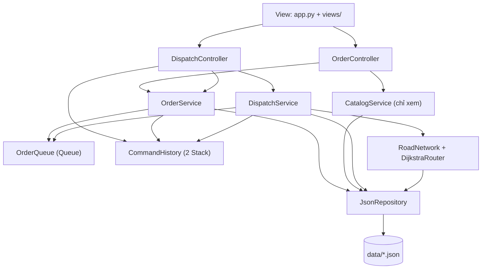
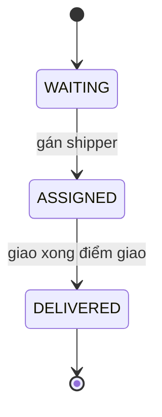

# Hệ thống Quản lý Đơn hàng & Gợi ý Shipper

> Đồ án Module 1: Xây dựng ứng dụng quản lý tương tác bằng Python.
> Nhóm: `DUT_AI` · Mentor: `Quế Đình Anh Tú` · Repo: `https://github.com/HcmusGo/Report-Module_1`

## 1. Giới thiệu

Ứng dụng mô phỏng một **cửa hàng giao hàng** với hai việc gắn liền nhau:

1. **Quản lý đơn hàng:** thêm, sửa, xóa, tìm kiếm, lọc đơn; các đơn chưa có shipper xếp trong **hàng đợi** theo thứ tự đến trước, xử lý trước.
2. **Gợi ý shipper phù hợp và đường đi nhanh nhất:** với mỗi đơn, hệ thống đánh giá từng shipper (còn đủ sức chở không, kịp hạn giao không, mất bao lâu) rồi đề xuất người phù hợp nhất cùng lộ trình tìm bằng **Dijkstra**.

Mọi thao tác thay đổi dữ liệu đều **Undo / Redo** được. Dữ liệu lưu bằng file JSON, không dùng database.

### Phạm vi 

| Đã bỏ | Thay bằng |
|---|---|
| Thêm, sửa, xóa món, khách hàng, shipper, địa điểm, đường | Khởi tạo sẵn trong `data/sample/*.json`, giao diện chỉ xem |
| Khóa / mở đường | Đường nạp sẵn kèm **mức đông** (vắng, vừa, đông): có đường gần nhưng đông, có đường xa nhưng vắng |
| Thực đơn, khách hàng, phí ship | Đơn chỉ có tên khách, điểm lấy, điểm giao, khối lượng, hạn giao |
| Kiến trúc nhiều thành phần | 3 tầng gọn Controller – Service – Repository, một `JsonRepository` dùng chung cho mọi dữ liệu |
| BFS đối chứng | So sánh đường "ngắn nhất theo km" với "nhanh nhất theo phút" |

Phần CRUD (thêm, sửa, xóa, tìm kiếm, lọc) tập trung vào **đơn hàng**, đáp ứng yêu cầu màn hình quản lý dữ liệu của đề.

## 2. Tính năng

- [ ] CRUD đơn hàng: thêm, sửa, xóa, tìm kiếm theo từ khóa, lọc theo trạng thái
- [ ] Hàng đợi đơn chờ (FIFO)
- [ ] Dijkstra tìm đường nhanh nhất theo thời gian, có xét mức đông của từng đường
- [ ] Đề xuất shipper phù hợp: kiểm tra sức chở, hạn giao, thời gian di chuyển
- [ ] Gán đơn cho shipper, quản lý lộ trình (các điểm lấy / giao còn lại), hoàn thành từng điểm dừng
- [ ] Undo / Redo bằng Stack, mỗi lệnh chụp snapshot trước khi thay đổi
- [ ] Lưu và khôi phục dữ liệu qua JSON, dữ liệu khởi tạo sẵn, xử lý lần chạy đầu

## 3. Công nghệ

| Hạng mục | Công cụ |
|---|---|
| Ngôn ngữ | Python 3.11+ (khuyến nghị) |
| Quản lý dự án | [uv](https://docs.astral.sh/uv/) (`pyproject.toml`, `uv.lock`) |
| Giao diện | Streamlit, Plotly (vẽ bản đồ) |
| Lưu trữ | JSON trong thư mục `data/` |
| Kiểm thử | pytest |
| Quản lý mã nguồn | Git / GitHub, nhánh riêng cho từng người, Pull Request |

## 4. Cài đặt và chạy

```bash
# 1. Cài uv (nếu chưa có)
pip install uv

# 2. Lấy mã nguồn
git clone https://github.com/HcmusGo/Report-Module_1.git
cd Report-Module_1

# 3. Đồng bộ môi trường theo pyproject.toml / uv.lock
uv sync

# 4. Chạy ứng dụng
uv run streamlit run src/app.py
```

Mở trình duyệt tại `http://localhost:8501`. Chạy kiểm thử: `uv run pytest`.

Thêm thư viện mới (chỉ làm trong nhánh của mình, rồi commit cả `pyproject.toml` và `uv.lock`):

```bash
uv add <tên-thư-viện>
uv add --dev pytest
```

> **Lưu ý khi phát triển:** `AppContext` được giữ trong `st.session_state`. Sau khi sửa code, nếu giao diện vẫn chạy theo bản cũ thì tải lại trang (F5).
>
> Khi chạy `streamlit run src/app.py`, thư mục `src/` nằm trong `sys.path`, nên import theo dạng `from services.order_service import OrderService`, **không** dùng `from src.services...`. File `pytest.ini` đã cấu hình `pythonpath = src` cho test.

## 5. Kiến trúc 3 tầng

**Phụ thuộc chỉ đi một chiều từ trên xuống, tầng dưới không bao giờ import tầng trên:**

```
View  →  Controller  →  Service  →  Repository  →  data/*.json
                                 ↘  Models (entity) dùng chung cho mọi tầng
```

| Tầng | Thư mục | Làm gì | Không được làm |
|---|---|---|---|
| **View** | `src/app.py`, `src/views/` | Vẽ giao diện Streamlit, gọi Controller, hiển thị kết quả | Chứa luật nghiệp vụ, gọi Service hay Repository trực tiếp |
| **Controller** | `src/controllers/` | Nhận thao tác từ giao diện, gọi Service, bắt lỗi và trả `Result`, đổi dữ liệu thành bảng để hiển thị | Chứa luật nghiệp vụ, import `streamlit` |
| **Service** | `src/services/` | Toàn bộ nghiệp vụ: đơn hàng, hàng đợi, Undo / Redo, đồ thị, Dijkstra, đề xuất shipper | Import `streamlit`, đọc ghi file |
| **Repository** | `src/repositories/` | Đọc, ghi, tìm dữ liệu JSON | Chứa luật nghiệp vụ |
| **Models** | `src/models/` | Thực thể, kiểm tra dữ liệu hợp lệ, `to_dict()` / `from_dict()` | Biết đến tầng khác |

Việc ghép nối các tầng nằm ở một chỗ duy nhất là `src/container.py` (**Dependency Injection**): Service nhận Repository qua constructor và chỉ biết giao diện `Repository`.



### Cấu trúc thư mục

```
Report-Module_1/
├── data/
│   └── sample/                  # Dữ liệu khởi tạo sẵn (có commit): places, roads, shippers, orders
│                                # File chạy thật (data/*.json) nằm trong .gitignore
├── src/
│   ├── app.py                   # View: dựng trang, 2 tab
│   ├── container.py             # Ghép Repository → Service → Controller
│   ├── config.py                # Đường dẫn data, tốc độ theo mức đông
│   ├── exceptions.py            # AppError, ValidationError, NotFoundError, BusinessRuleError
│   ├── views/
│   │   ├── orders_tab.py        # Tab 1: Quản lý đơn hàng
│   │   └── dispatch_tab.py      # Tab 2: Điều phối đơn (gồm vẽ bản đồ Plotly)
│   ├── controllers/
│   │   ├── result.py            # Result(ok, message, data)
│   │   ├── order_controller.py
│   │   └── dispatch_controller.py
│   ├── services/
│   │   ├── order_service.py     # CRUD, tìm kiếm, lọc đơn
│   │   ├── order_queue.py       # Hàng đợi đơn chờ (deque)
│   │   ├── dispatch_service.py  # Đề xuất shipper, gán đơn, hoàn thành điểm dừng
│   │   ├── routing.py           # RoadNetwork, Router (ABC), DijkstraRouter
│   │   ├── history.py           # Command (ABC) + CommandHistory (2 Stack)
│   │   ├── commands.py          # CreateOrderCmd, UpdateOrderCmd, DeleteOrderCmd, ...
│   │   └── catalog_service.py   # Xem địa điểm, đường, shipper (chỉ đọc)
│   ├── repositories/
│   │   ├── base_repository.py   # Repository (ABC)
│   │   └── json_repository.py   # Một lớp cho cả 4 loại dữ liệu
│   └── models/
│       ├── base.py              # BaseEntity: to_dict() / from_dict()
│       ├── order.py             # Order, OrderStatus, quy tắc chuyển trạng thái
│       ├── shipper.py           # Shipper, Stop, StopKind
│       └── map_entities.py      # Place, Road, PlaceKind, TrafficLevel
├── tests/                       # Unit test (đã có test_smoke.py, test_seed_data.py)
├── DOCUMENT/                    # Report mô tả dự án
├── .github/                     # PR template, CODEOWNERS
├── pytest.ini, pyproject.toml, uv.lock, .gitignore, README.md
```

## 6. Nghiệp vụ

### Các đối tượng

| Đối tượng | Ý nghĩa | Trường chính |
|---|---|---|
| `Order` | Đơn hàng | `id`, `customer_name`, `pickup_node`, `delivery_node`, `weight_kg`, `deadline_min` (hạn giao, phút, có thể trống), `status`, `shipper_id`, `note`, `created_at` |
| `Shipper` | Người giao hàng | `id`, `name`, `node_id` (vị trí), `capacity_kg` (sức chở tối đa), `load_kg` (tải hiện tại), `route` (Queue các `Stop`) |
| `Stop` | Một điểm dừng trong lộ trình | `order_id`, `node_id`, `kind` (`PICKUP` hoặc `DELIVERY`) |
| `Place` | Nút trên bản đồ | `id`, `name`, `x`, `y`, `kind` (`SHOP`, `JUNCTION`, `HOME`) |
| `Road` | Đường hai chiều nối hai địa điểm | `id`, `a`, `b`, `distance_km`, `traffic` (`LOW`, `MEDIUM`, `HIGH`), thuộc tính `minutes` |

Quan hệ: một `Order` thuộc tối đa một `Shipper`; lộ trình của `Shipper` gồm các `Stop` trỏ về `Order`; `Order` và `Shipper` đứng tại một `Place`; các `Place` nối nhau bằng `Road`.

### Vòng đời đơn hàng



Luật chuyển trạng thái nằm **một chỗ duy nhất** là `ALLOWED_TRANSITIONS` trong `models/order.py`. Chỉ đơn `WAITING` mới sửa hoặc xóa được.

### Thời gian di chuyển phụ thuộc mức đông

`thời gian (phút) = distance_km / tốc độ(traffic) × 60`, tốc độ trung bình theo `config.py`: vắng 40 km/h, vừa 25 km/h, đông 10 km/h. Vì vậy **đường ngắn nhất theo km chưa chắc nhanh nhất**. Ví dụ trong dữ liệu mẫu, từ Cửa hàng đến Khu Hoa Sen:

| Tiêu chí | Đường đi | Quãng đường | Thời gian |
|---|---|---|---|
| Ngắn nhất theo km | Cửa hàng → Ngã tư Trung tâm → Khu Hoa Sen (đường đông) | 3,0 km | 18,0 phút |
| Nhanh nhất theo phút | Cửa hàng → Ngã tư Chợ → Khu Hoa Sen (đường vắng) | 4,1 km | 6,15 phút |

### Thuật toán đề xuất shipper cho một đơn

Với **mỗi** shipper, `DispatchService.suggest()` làm lần lượt:

1. Điểm bắt đầu = điểm cuối lộ trình hiện tại (lộ trình rỗng thì lấy vị trí hiện tại).
2. Loại với lý do **vượt tải** nếu `load_kg + weight_kg > capacity_kg`.
3. Tính `ETA` = thời gian đi hết lộ trình hiện tại + thời gian đến điểm lấy hàng + thời gian từ điểm lấy đến điểm giao (đều bằng Dijkstra theo thời gian).
4. Loại với lý do **trễ hạn** nếu đơn có `deadline_min` và `ETA` lớn hơn hạn đó.
5. Sắp xếp các shipper phù hợp theo `ETA` tăng dần (hòa thì tải nhẹ hơn trước), shipper bị loại xếp sau kèm lý do.

Kết quả với dữ liệu mẫu:

| Đơn | Khối lượng, hạn | S01 | S02 (đang giao O005, còn trống 5 kg) | S03 |
|---|---|---|---|---|
| O001 → Khu Hoa Sen | 3 kg, hạn 20 phút | **6,15 phút** | loại: trễ hạn (25,35) | 13,35 phút |
| O002 → Khu Biển Xanh | 8 kg, hạn 30 phút | **10,5 phút** | loại: vượt tải | 17,7 phút |
| O004 → Chung cư Sao Mai | 12 kg, không hạn | **10,5 phút** | loại: vượt tải | loại: vượt tải |

### Đơn giản hóa so với ví dụ của mentor

Chưa có giờ chuẩn bị hàng xong và thể tích, chỉ khối lượng; hạn giao tính bằng phút kể từ lúc gán đơn chứ chưa có đồng hồ thật; đơn mới luôn thêm vào **cuối** lộ trình của shipper, chưa tối ưu thứ tự chèn.

## 7. Cấu trúc dữ liệu, thuật toán và mẫu thiết kế

| Cấu trúc / Thuật toán | Dùng ở đâu | Vì sao chọn | Độ phức tạp |
|---|---|---|---|
| **Dict** | Index theo `id` trong `JsonRepository`, danh sách kề của đồ thị | Tra cứu, sửa, xóa theo khóa | O(1) |
| **Queue** (`deque`) | `OrderQueue` (đơn chờ), `Shipper.route` (các điểm dừng) | FIFO, `popleft()` nhanh hơn `list.pop(0)` | O(1) |
| **Stack** (`list`) | `CommandHistory`: `undo_stack`, `redo_stack` | LIFO, hoàn tác thao tác gần nhất trước | O(1) |
| **Priority Queue** (`heapq`) | `DijkstraRouter` | Luôn lấy nút có chi phí nhỏ nhất | O(log n) |
| **Set** | Tập `visited` | Kiểm tra thuộc tập nhanh | O(1) |
| **Dijkstra** | Đường nhanh nhất, tính `ETA` của từng shipper | Cạnh có trọng số không âm | O((V+E) log V) |

| Mẫu | Ở đâu | Tác dụng |
|---|---|---|
| **Repository** | `repositories/` | Tách việc lưu trữ khỏi nghiệp vụ |
| **Command** | `history.py`, `commands.py` | Mỗi thao tác có `apply()` và `undo()` |
| **Dependency Injection** | `container.py` | Service nhận phụ thuộc qua constructor, dễ kiểm thử |
| **Strategy** | `routing.py` | `Router` (ABC) → `DijkstraRouter`, dễ thay thuật toán |

### Quy tắc Snapshot cho Undo / Redo (góp ý của mentor)

- `apply()` phải **chụp lại trạng thái trước khi thay đổi** (`to_dict()` hoặc `copy.deepcopy`) và lưu vào thuộc tính của Command.
- `undo()` chỉ **khôi phục từ snapshot đó**, **không gán cứng giá trị mặc định** (không viết `status = WAITING` hay `load_kg = 0`).
- `Redo` gọi lại `apply()` nên mỗi lần phải chụp snapshot mới. Snapshot là bản sao độc lập, không giữ tham chiếu đến đối tượng đang sửa.
- Khi có thao tác mới, `redo_stack` bị xóa.

| Lệnh | Thao tác | Snapshot chụp trong `apply()` |
|---|---|---|
| `CreateOrderCmd` | Thêm đơn, đưa vào hàng đợi | Chính đơn vừa tạo (giữ id) |
| `UpdateOrderCmd` | Sửa đơn `WAITING` | `_before_order`: đơn trước khi sửa |
| `DeleteOrderCmd` | Xóa đơn `WAITING` | `_before_order` và `_before_queue_index` (vị trí cũ trong hàng đợi) |
| `AssignOrderCmd` | Gán đơn cho shipper | `_before_order`, `_before_shipper` (gồm route và `load_kg`), `_before_queue_index` |
| `CompleteStopCmd` | Shipper xong một điểm dừng | `_before_shipper` (route, vị trí, `load_kg`) và `_before_order` |

## 8. Dữ liệu và lưu trữ

| File | Nội dung | Có sửa qua giao diện không |
|---|---|---|
| `data/orders.json` | Đơn hàng | Có (thêm, sửa, xóa đơn `WAITING`; trạng thái đổi khi gán, giao) |
| `data/shippers.json` | Shipper, tải trọng, lộ trình | Chỉ thay đổi khi gán đơn, hoàn thành điểm dừng |
| `data/places.json` | 11 địa điểm: 1 cửa hàng, 5 ngã tư, 5 điểm giao | Không, chỉ xem |
| `data/roads.json` | 20 đường kèm mức đông | Không, chỉ xem |

- Dữ liệu khởi tạo nằm ở `data/sample/` (có commit). Lần chạy đầu, nếu chưa có file trong `data/` thì **chép từ `data/sample/`**, không có mẫu thì tạo danh sách rỗng. Ứng dụng không được crash.
- File JSON hỏng: đổi tên thành `.bak` rồi khởi tạo lại từ mẫu.
- Ghi file với `encoding="utf-8"` và `ensure_ascii=False` để không lỗi tiếng Việt.
- Chỉ **Repository** được đọc ghi `data/`. Ai sửa file mẫu thì chạy `uv run pytest`, `tests/test_seed_data.py` kiểm tra id tham chiếu đúng, bản đồ liên thông và tải trọng khớp với đơn đã gán.

## 9. Giao diện

| Tab | Nội dung |
|---|---|
| **1. Quản lý đơn hàng** | Bảng đơn (tìm theo từ khóa, lọc theo trạng thái), form thêm / sửa / xóa đơn; bên dưới là các bảng chỉ xem: địa điểm, đường kèm mức đông, shipper |
| **2. Điều phối đơn** | Hàng đợi đơn chờ; nút "Đề xuất shipper" hiện bảng mọi shipper (phù hợp hay không, lý do, ETA); nút "Xác nhận gán"; lộ trình từng shipper và nút "Hoàn thành điểm dừng tiếp theo"; bản đồ (đường tô màu theo mức đông, tuyến được chọn tô đậm); bảng so sánh "ngắn nhất theo km" với "nhanh nhất theo phút"; nút Undo / Redo |

`app.py` chỉ dựng khung trang và gọi `views/`. `AppContext` được giữ trong `st.session_state`, nếu không Stack Undo bị reset sau mỗi lần bấm nút. Giao diện gọi hàm Controller, nhận `Result` rồi hiển thị bằng `st.success` hoặc `st.error`.

## 10. Nhóm thực hiện và phân công

Nhóm 5 thành viên. Khối lượng chia theo độ phức tạp: ba phần **Core Logic**, **Routing** và **UI**

| STT | Họ tên | GitHub | Vai trò | Branch | 
|---|---|---|---|---|---|
| 1 | Lê Trí Tiên | `@HcmusGo` | Trưởng nhóm, Core Logic | `feat/logic` | 
| 2 | Đào Đoàn Đỗ Quyên | `@DUT26DoQuyen` | Models và dịch vụ xem danh mục | `feat/models` | 
| 3 | Nguyễn Lê Đức Bảo | `@cleivoid` | Routing và đề xuất shipper | `feat/routing` | 
| 4 | Nguyễn Vũ Băng Tâm | `@btam200801` | Repository, dữ liệu mẫu, kiểm thử | `feat/repository` | 
| 5 | Thân Văn Thế Lâm | `@thanvanthelam` | Controller, giao diện, tích hợp | `feat/ui` | 

### Nhiệm vụ chi tiết

**Lê Trí Tiên: Trưởng nhóm, Core Logic**
- Quản lý repo, điều phối merge PR, chốt "hợp đồng hàm" giữa các tầng
- `services/order_service.py`: thêm, sửa, xóa, tìm kiếm, lọc đơn, dựng lại hàng đợi khi khởi động
- `services/order_queue.py`: hàng đợi (`enqueue`, `dequeue`, `peek`, `remove`, `index_of`, `insert_at`)
- `services/history.py`, `services/commands.py`: Undo / Redo bằng 2 Stack, **mọi lệnh theo quy tắc Snapshot**
- `container.py`, `config.py`, `exceptions.py`

**Nguyễn Lê Đức Bảo: Routing và đề xuất shipper**
- `services/routing.py`: `RoadNetwork`, `Router`, `DijkstraRouter` (nhanh nhất theo phút, ngắn nhất theo km)
- `services/dispatch_service.py`: `suggest`, `best`, `assign`, `complete_next_stop`, `route_minutes`, `compare_time_vs_distance`

**Thân Văn Thế Lâm: Controller, giao diện, tích hợp**
- `controllers/`: `OrderController`, `DispatchController`, `Result`
- `app.py`, `views/`: Streamlit 2 tab, `st.session_state`, form CRUD đơn, bản đồ Plotly
- Thông báo thành công / lỗi, nút Undo / Redo (vô hiệu hóa khi Stack rỗng), `st.rerun()`
- Tích hợp các tầng, chuẩn bị bản demo

**Đào Đoàn Đỗ Quyên: Models và dịch vụ xem danh mục**
- `models/`: `BaseEntity`, `Order`, `Shipper`, `Stop`, `Place`, `Road` và các Enum
- Đóng gói (thuộc tính private + property), validate trong setter, `to_dict()` / `from_dict()`
- `services/catalog_service.py`: xem địa điểm, đường, shipper
- Unit test cho models và catalog

**Nguyễn Vũ Băng Tâm: Repository, dữ liệu mẫu, kiểm thử**
- `repositories/`: `Repository` (ABC), `JsonRepository`; tạo file khi chưa có, xử lý JSON hỏng, ghi UTF-8
- `data/sample/` (giữ `tests/test_seed_data.py` luôn qua), `.gitignore`, `pytest.ini`
- Bảng test case, unit test cho repository và routing (phối hợp với Bảo), kiểm thử tích hợp
- Kịch bản demo, cập nhật README và ảnh chụp giao diện

### Phân công tài liệu (thư mục `DOCUMENT/`)

| Người | Phần tài liệu |
|---|---|
| Tiên | Giới thiệu, phạm vi, kiến trúc 3 tầng, quy tắc Snapshot, biên tập tổng |
| Quyên | Yêu cầu, các đối tượng và quy tắc nghiệp vụ, thiết kế thực thể, Phụ lục |
| Bảo | Cấu trúc dữ liệu và thuật toán, thuật toán đề xuất shipper (ví dụ chạy tay) |
| Lâm | Thiết kế giao diện, wireframe |
| Tâm | Lưu trữ (Repository), dữ liệu mẫu, kế hoạch và Git, kiểm thử và nghiệm thu |

### Nguyên tắc chung

- **Mọi thành viên đều có commit và Pull Request** trong suốt dự án, phần việc nhẹ hơn không có nghĩa là ít đóng góp trong lịch sử Git.
- Mỗi thành viên giải thích được **kiến trúc tổng thể** và lý do chọn từng cấu trúc dữ liệu, không chỉ phần của mình.
- Tỷ trọng chỉ là ước tính ban đầu, nhóm điều chỉnh nếu phần nào phát sinh nhiều việc.

### Review chéo

| Pull Request | Tác giả | Reviewer chính |
|---|---|---|
| `feat/models` | Đào Đoàn Đỗ Quyên | Nguyễn Lê Đức Bảo |
| `feat/repository` | Nguyễn Vũ Băng Tâm | Đào Đoàn Đỗ Quyên |
| `feat/logic` | Lê Trí Tiên | Thân Văn Thế Lâm |
| `feat/routing` | Nguyễn Lê Đức Bảo | Nguyễn Vũ Băng Tâm |
| `feat/ui` | Thân Văn Thế Lâm | Lê Trí Tiên |

## 11. Quy ước Git và GitHub

### Nhánh và Pull Request

- `main` là nhánh sản phẩm, **không push trực tiếp**. Mọi thay đổi đi qua Pull Request, có ít nhất 1 người review (bảng review chéo ở mục 10).
- Mỗi người làm trên nhánh riêng, **không ai sửa chung một nhánh**.
- Merge bằng **Create a merge commit** (không Squash) để giữ nguyên từng commit của mỗi thành viên. Nhánh tự xóa sau khi merge.

| Loại | Mẫu tên nhánh | Ví dụ |
|---|---|---|
| Tính năng | `feat/<module>-<mô tả>` | `feat/logic-undo-stack` |
| Sửa lỗi | `fix/<mô tả>` | `fix/repository-empty-file` |
| Tài liệu | `docs/<chương>` | `docs/requirements` |
| Test | `test/<module>` | `test/routing-dijkstra` |
| Việc lặt vặt | `chore/<mô tả>` | `chore/add-plotly` |

Dùng dấu `-` thay vì `/` ở phần mô tả, vì Git không cho tồn tại cùng lúc `feat/logic` và `feat/logic/undo`. Các nhánh `feat/models`, `feat/repository`, `feat/logic`, `feat/routing`, `feat/ui` ở mục 10 là nhánh đầu tiên của mỗi người. Sau khi merge thì tạo nhánh mới từ `main`.

### Quy trình mỗi lần làm việc

```bash
git checkout main && git pull origin main        # 1. lấy main mới nhất
git checkout -b feat/logic-undo-stack            # 2. tạo nhánh riêng
# ... code ...
git add src/services/history.py                  # 3. add đúng file, tránh git add .
git commit -m "feat: add undo stack for order commands"
git fetch origin && git merge origin/main        # 4. kéo main mới về nhánh mình, sửa conflict ở đây
git push -u origin feat/logic-undo-stack         # 5. đẩy nhánh lên
```

Sau đó mở Pull Request trên GitHub, điền template, gắn reviewer, sửa theo comment, được approve thì **Merge pull request**.

### Tránh xung đột

- **Mỗi file một chủ.** File nào của ai xem mục 10 và `.github/CODEOWNERS`. Cần sửa file của người khác thì nhắn họ, hoặc mở PR nhỏ và gắn họ review.
- `pyproject.toml` và `uv.lock`: ai cần thêm thư viện thì báo nhóm, làm PR nhỏ `chore/add-<thư viện>` và merge ngay.
- PR nhỏ (khoảng dưới 300 dòng), mở sớm, review trong nửa ngày. Không tự merge PR khi chưa có approve.
- Mỗi sáng `git pull origin main`, và merge `main` vào nhánh của mình ít nhất mỗi ngày.
- **Không** `git push --force`.

Khi bị conflict:

```bash
git checkout <nhánh-của-bạn>
git fetch origin && git merge origin/main
# Mở file, tìm <<<<<<<  =======  >>>>>>>, giữ nội dung đúng rồi xóa các dấu này
git add <file đã sửa>
git commit
git push
```

Với `uv.lock`, không sửa tay: sửa `pyproject.toml` xong thì chạy `uv lock` rồi `git add uv.lock`.

### Commit và file không được commit

- Commit message dạng: `feat: ...`, `fix: ...`, `docs: ...`, `test: ...`, `refactor: ...`, `chore: ...`.
- Không commit `.venv/`, `__pycache__/`, `.pytest_cache/`, dữ liệu chạy thật (`data/*.json`), file test tạm.
- Cấu hình `git config user.email` trùng email của tài khoản GitHub, nếu không commit sẽ không tính vào đóng góp của bạn.

## 12. Kịch bản demo

1. Mở ứng dụng lần đầu khi chưa có file dữ liệu (ứng dụng tự tạo từ dữ liệu mẫu).
2. Tab 1: thêm một đơn mới, sửa khối lượng, xóa một đơn, tìm kiếm và lọc theo trạng thái.
3. Tab 2: chọn đơn đầu hàng đợi, bấm "Đề xuất shipper", xem bảng so sánh (có shipper bị loại vì vượt tải hoặc trễ hạn).
4. Mở bảng so sánh đường: "ngắn nhất theo km" mất 18 phút, "nhanh nhất theo phút" chỉ 6,15 phút.
5. Bấm "Xác nhận gán", xem lộ trình của shipper có thêm hai điểm dừng và tải trọng tăng.
6. Bấm "Hoàn thành điểm dừng tiếp theo" cho đến khi đơn chuyển `DELIVERED`.
7. Bấm **Undo** nhiều lần rồi **Redo**: tải trọng, lộ trình, trạng thái đơn và vị trí trong hàng đợi trở về đúng như trước.
8. Tắt và mở lại ứng dụng, dữ liệu vẫn còn.

## 13. Đối chiếu tiêu chí đánh giá

| Tiêu chí | Cách dự án đáp ứng |
|---|---|
| Quản lý dự án và Git | `uv` + `pyproject.toml` + `uv.lock`; nhánh riêng cho từng người; PR có review; mọi thành viên có commit |
| OOP và Clean Code | 3 tầng Controller – Service – Repository; đóng gói bằng thuộc tính private; kế thừa qua `BaseEntity`, `Repository`, `Command`, `Router`; Dependency Injection; `app.py` không chứa logic |
| Cấu trúc dữ liệu và lưu file | Dict, Queue (đơn chờ, lộ trình), Stack (Undo / Redo), Priority Queue, Set; Dijkstra; JSON trong `data/`, xử lý file chưa có và file hỏng |
| Giao diện và trải nghiệm | 2 tab Streamlit; phản hồi ngay khi thêm / sửa / xóa / gán / Undo / Redo; thông báo thành công và lỗi |
| Trình bày | Kịch bản demo ở mục 12; mỗi thành viên nắm kiến trúc tổng thể |

## 14. Tài liệu

Report mô tả dự án nằm trong thư mục `DOCUMENT/`, mỗi chương một file. Người phụ trách từng chương xem ở mục 10.

Link Documents đã nộp cho mentor: `https://surl.li/aguqnx`
